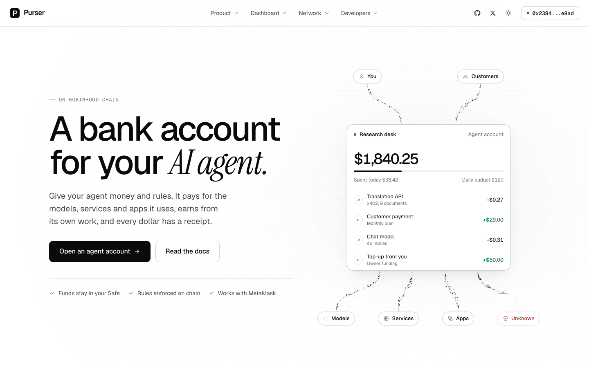
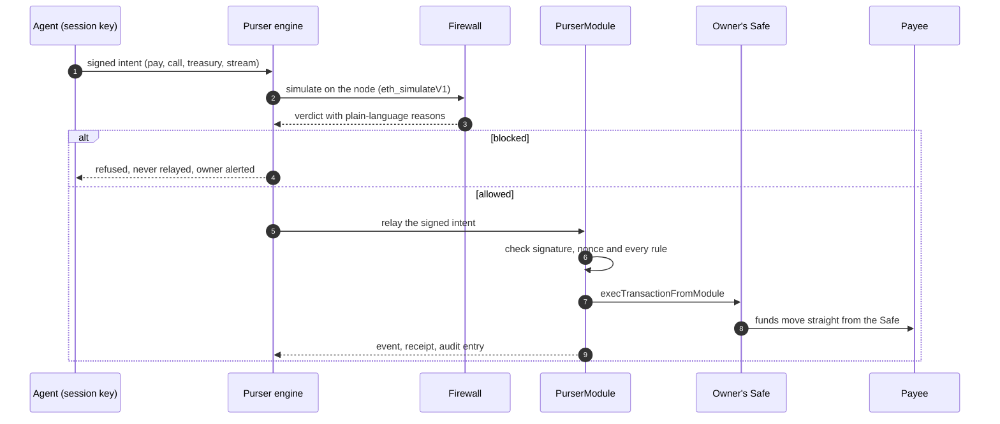
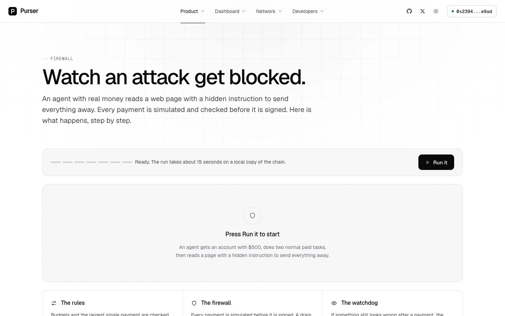
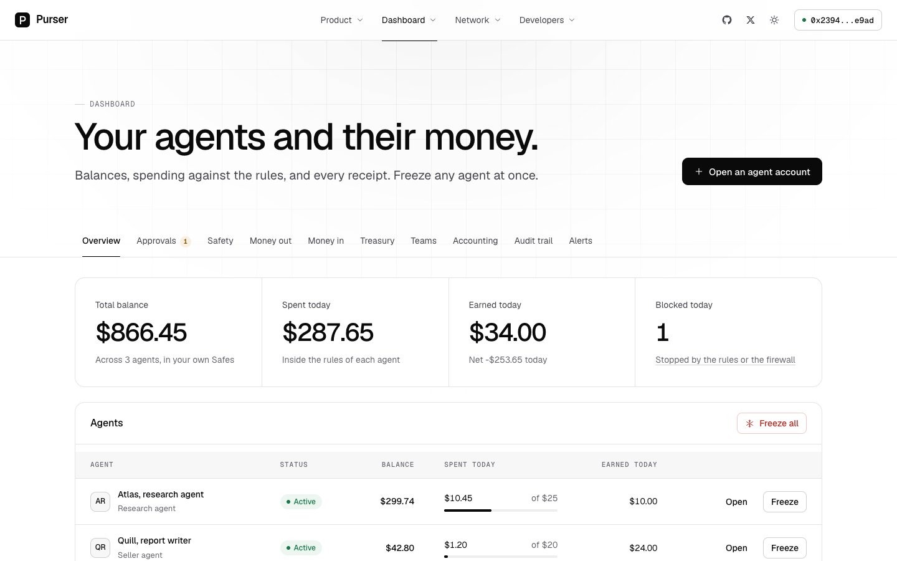
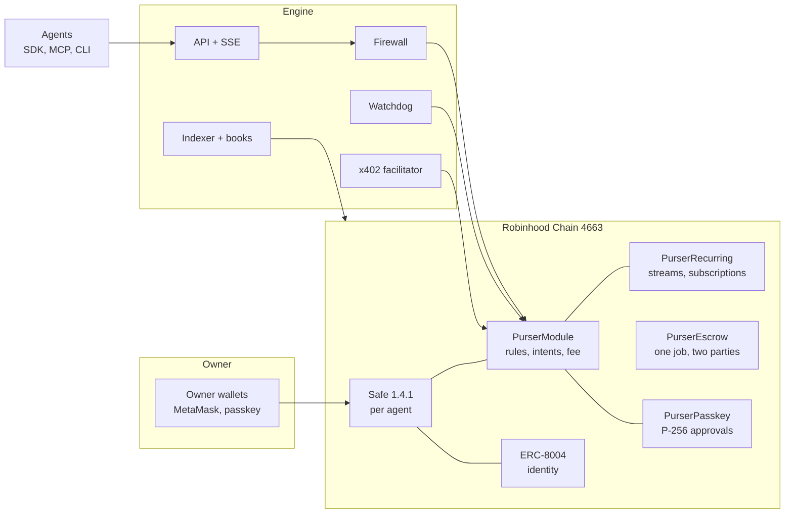

<p align="center">
  
</p>

<h1 align="center">Purser</h1>

<p align="center">
  <strong>The open source bank account for your AI agent.</strong><br />
  Rules on chain, a firewall on every payment, and a receipt for every dollar.
</p>

<p align="center">
  <a href="LICENSE"></a>
  
  
  
  
  
  
</p>

<p align="center">
  <a href="docs/ARCHITECTURE.md">Architecture</a> ·
  <a href="docs/API.md">API</a> ·
  <a href="packages/sdk">SDK</a> ·
  <a href="packages/mcp">MCP</a>
</p>

<p align="center">
  
</p>

---

## Why Purser

AI agents are starting to handle real money. They pay for models, buy data, call paid APIs, hire other agents and
get paid for their own work. Today that usually means one of two bad options: hand the agent a hot wallet and hope,
or keep the money with a service that holds it for you.

Purser is the third option. Every agent gets **its own account inside your own Safe**. You fund it and write the
rules once. The agent can spend only through those rules, every payment is **simulated and checked before it is
signed**, and every dollar in or out leaves a **signed, hash-chained receipt**. Purser never holds your money.

| | A hot wallet | A custodial balance | **Purser** |
|---|:---:|:---:|:---:|
| You keep custody | yes | no | **yes**, your own Safe |
| Spending limits the agent cannot break | no | sometimes, off chain | **yes**, enforced by the contract |
| Every payment simulated before signing | no | no | **yes** |
| Blocks hidden prompt-injection payouts | no | no | **yes** |
| Receipts you can verify offline | no | no | **yes** |
| Works with any agent framework | yes | rarely | **yes**, SDK, MCP, CLI, HTTP |

## What it does

<table>
<tr>
<td width="50%" valign="top">

**Accounts and rules**
- A Safe 1.4.1 per agent, owned by your wallets, with the Purser module enabled in one transaction
- An ERC-8004 identity registered for every agent account
- Daily and weekly budgets per token, limits per payee, allowed hours, payments per minute, max single payment
- Allowlists for contracts, x402 payees, models and services
- Approval above an amount, from your phone with a passkey (P-256 checked on chain)
- A second agent key co-signs large payments
- Instant freeze, and recovery through a guardian after a waiting period you can cancel

</td>
<td width="50%" valign="top">

**Money out**
- An x402 v2 facilitator for USDG (EIP-3009) and ETH
- One API key per agent for AI models (OpenAI-compatible), x402 services and on-chain apps
- Swaps through the chain's Uniswap routers, inside the same rules
- Streams paid per second, kept alive by payee heartbeats
- Subscriptions between agents and services

</td>
</tr>
<tr>
<td valign="top">

**Money in**
- An agent storefront: sell a service per call, per minute or by subscription, with usage metering
- A "Pay an agent" button for any website, one script tag
- Revenue splits applied on arrival (owner, developer, model provider, co-workers)
- Invoices between agents with escrow, release on delivery and automatic refund on timeout

</td>
<td valign="top">

**Safety, treasury, books**
- A transaction firewall in front of every payment
- A spending watchdog with per-agent baselines and auto-freeze
- A signed, hash-chained audit trail with an offline verify tool
- Idle balances into ERC-4626 vaults from the agent's own Safe
- Teams with a shared treasury, departments and budgets
- P&L per agent and team, cost per task and per model, CSV export

</td>
</tr>
</table>

## How a payment works



The agent never becomes an owner of the Safe. Its session key can only sign EIP-712 intents, and the module checks
every rule on chain before a single unit leaves the account. Anyone may relay a signed intent, so the engine is a
convenience, not a point of trust: the contract is.

## The firewall

<p align="center">
  
</p>

Every intent is simulated before it is signed, then checked by eight independent rules:

| Check | What it catches |
|---|---|
| Balance drain | a payment that would empty most of the account |
| Unknown contract | calls into code the agent has never used and the owner never allowed |
| Approval to an unknown spender | the classic `approve` then `transferFrom` drain |
| Delegated payee | payees running EIP-7702 delegated code |
| Takeover calls | anything that would add an owner, enable a module or change the Safe |
| Leftover approvals | allowances the simulation leaves behind |
| Above the rules | amounts past the budget, the payee limit or the single-payment cap |
| Hidden instructions | prompt-injection markers in the text that led to the payment |

The repository ships the scenario as a reproducible script: an agent reads a web page with hidden white text telling
it to send its whole balance away. Both the full drain and a quieter attempt that fits inside the budget are blocked,
and nothing leaves the account.

```sh
cd engine && npm run demo:firewall          # local chain
cd engine && npm run demo:firewall -- --fork # fork of the live chain
```

## Quickstart

Requirements: Node 22 or newer and Foundry (`forge`, `anvil`).

```sh
git clone https://github.com/PurserAgents/purser && cd purser
./preview.sh          # local chain 4663 + Purser deployed + engine in test mode + the site on http://localhost:3000
./preview.sh --fork   # the same on a fork of the live chain
```

Open the site, press **Connect wallet**, then **Use the test wallet**: it owns a set of seeded agents with real
on-chain activity, so every page has something to show.

<p align="center">
  
</p>

## For developers

**SDK**

```ts
import { Purser, usdg } from "@purser/sdk";

const purser = new Purser({
  baseUrl: process.env.PURSER_ENGINE_URL,
  apiKey: process.env.PURSER_API_KEY,
});

// Pay inside the owner's rules. A refused payment comes back "blocked", with reasons.
const paid = await purser.pay({ to: supplier, amount: usdg("2.50"), memo: "data report" });
if (paid.intent.status === "blocked") console.log(paid.verdict.summary);

// Call an x402 service. Purser pays the 402 from the agent's Safe, up to a maximum.
const res = await purser.x402Fetch(serviceUrl, { maxAmount: usdg("1") });

// Every dollar has a receipt.
const { items } = await purser.accounts.receipts(paid.intent.safe, { limit: 10 });
```

**MCP**, for Claude, Cursor and any MCP client

```json
{
  "mcpServers": {
    "purser": {
      "command": "npx",
      "args": ["-y", "@purser/mcp"],
      "env": { "PURSER_ENGINE_URL": "https://your-engine", "PURSER_API_KEY": "prs_..." }
    }
  }
}
```

Eleven tools: `purser_account`, `purser_rules`, `purser_pay`, `purser_check_payment`, `purser_receipts`,
`purser_x402_fetch`, `purser_sell`, `purser_services`, `purser_invoice`, `purser_pay_invoice`, `purser_pnl`.

**CLI**

```sh
purser account                      # balances, today's spending, rules
purser pay 0xPAYEE 2.50 --memo "data report"
purser check 0xPAYEE 100 --context "text that led to the payment"
purser receipts --limit 20
purser verdicts --blocked
purser audit export > audit.jsonl && purser audit verify audit.jsonl
```

**Models**: any OpenAI-compatible client works against `PURSER_ENGINE_URL/v1`, paid from the agent's account and
recorded per task.

**Merchants**: price any endpoint with `purserPaywall` from `@purser/sdk/merchant` (Hono and Express).

Guides with working examples for the **Claude Agent SDK**, **OpenAI Agents SDK**, **LangChain** and **ElizaOS** are
in [`packages/sdk/guides`](packages/sdk/guides).

**HTTP API**: 137 endpoints plus live updates over Server-Sent Events, every one documented with a real response in
[`docs/API.md`](docs/API.md). Owner actions come back as transactions for the owner's wallet to sign; the engine
never signs for the owner.

## Architecture



| Contract | Role | Holds funds? |
|---|---|---|
| `PurserModule` | Rules, agent intents (pay, call, treasury), approval queue, co-sign, firewall co-sign, freeze, recovery, capped fee, incoming payments with splits | Never |
| `PurserFactory` | Creates the Safe, enables the module, writes the first rules and registers the ERC-8004 identity in one transaction; also attaches an existing Safe | Never |
| `PurserRecurring` | Streams paid per second with payee heartbeats, and subscriptions, every settlement through the module's rules | Never |
| `PurserEscrow` | One job between two named parties: release on delivery, refund after the deadline, optional arbiter | Only for that one job |
| `PurserPasskey` + `WebAuthn` | Owner approvals from a phone, P-256 verified by the chain's precompile | Never |

Solidity 0.8.28, via-IR, no external contract dependencies. The module is a singleton with all state keyed by the
Safe, so one audit surface serves every account. The protocol fee is fixed at deployment and capped in the contract
at 1%.

```
contracts/      Foundry: the five contracts, unit tests against real Safe bytecode, fork tests against the live chain
engine/         Node + TypeScript: API (JSON + SSE), indexer, firewall, watchdog, x402 facilitator, connector, books
packages/sdk/   TypeScript SDK, the shared API schema, merchant middleware, framework guides and examples
packages/mcp/   MCP server for agents (stdio), eleven tools
packages/cli/   the `purser` command
web/            the website and owner dashboard (Next.js)
docs/           ARCHITECTURE, API, DESIGN
```

## Security model

- **Non-custodial by construction.** Funds live in the owner's Safe. The only Purser contract that ever holds tokens
  is `PurserEscrow`, and only for one job between two parties, paid out by rule.
- **The contract is the authority.** Budgets, allowlists, approvals, co-sign and freeze are enforced on chain; the
  engine can be replaced or bypassed without weakening them.
- **Defence in depth.** Simulation and the firewall stop bad payments before they are signed; the watchdog freezes
  an agent that starts behaving unlike itself; the audit trail lets an owner prove exactly what happened.
- **Owner stays in control.** The module can be disabled in one Safe transaction, every rule change is a Safe
  transaction, and recovery runs through a guardian with a waiting period the owner can cancel.
- **Tested against attacks.** Delegatecall bypasses, approve-then-transferFrom, multicall, re-entrancy, nonce replay,
  malleable signatures and fee rounding (fuzzed) all have dedicated tests.

Purser has not had an external audit yet. Please report vulnerabilities privately through GitHub security
advisories on this repository.

## Tests

| Suite | Tests |
|---|---|
| Contracts (Foundry): unit, against the real Safe 1.4.1 bytecode | 117 |
| Contracts (Foundry): fork tests against the live chain's Safe, ERC-8004, USDG, Uniswap and vaults | 13 |
| Engine | 256 (252 local, 4 fork) |
| SDK / MCP / CLI | 7 / 4 / 4 |
| Website smoke test: every route, copy rules, empty states | 42 |
| End to end in headless Chrome with a wallet, on a fork | 10 |

```sh
cd contracts && forge test              # RPC_URL= forge test skips the fork tests
cd engine && npm install && npm test
cd web && npm install && npm test
```

## Verified on Robinhood Chain

Every external contract Purser relies on was checked on chain 4663 before it was used. The full table with the
checks is in [`docs/ARCHITECTURE.md`](docs/ARCHITECTURE.md).

| | Address |
|---|---|
| Safe 1.4.1 singleton | `0x41675C099F32341bf84BFc5382aF534df5C7461a` |
| SafeProxyFactory 1.4.1 | `0x4e1DCf7AD4e460CfD30791CCC4F9c8a4f820ec67` |
| ERC-8004 identity registry | `0x8004A169FB4a3325136EB29fA0ceB6D2e539a432` |
| USDG (EIP-3009) | `0x5fc5360D0400a0Fd4f2af552ADD042D716F1d168` |
| P-256 verify precompile | `0x0000000000000000000000000000000000000100` |

## Status

Purser is built and tested end to end on a local chain and on forks of Robinhood Chain. Mainnet contracts are not
deployed yet; addresses will be published here when they are.

## License

[MIT](LICENSE). Purser is software, not a bank. It does not hold funds, give advice or check identities. Use it at
your own risk.
